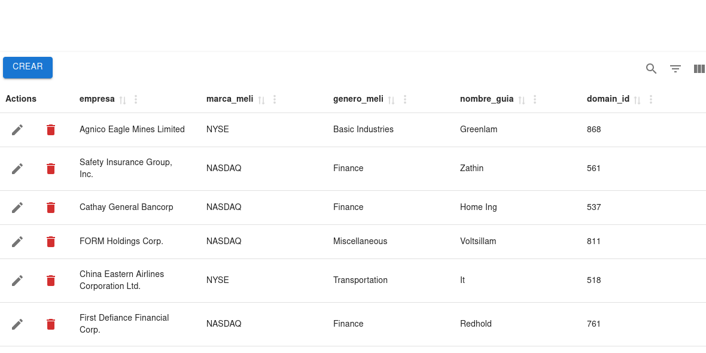

# CRUD Seven



Aplicación web de administración de registros (CRUD) construida con React y Material UI. Presenta una tabla de datos interactiva con datos de ejemplo, que permite crear, editar y eliminar registros mediante modales, junto con herramientas de búsqueda, filtrado, ordenamiento y personalización de columnas.

## Funcionalidades

- **Crear** registros desde un modal con validación de campos (selects para empresa, género y dominio).
- **Editar** cualquier fila en línea mediante un modal con los campos editables.
- **Eliminar** registros con confirmación.
- **Buscar** dentro de la tabla.
- **Filtrar** por columnas.
- **Ordenar** por cualquier columna.
- **Mostrar/ocultar columnas** y ajustar la densidad de filas.
- **Vista de pantalla completa**.

## Tecnologías

- [React 18](https://react.dev/)
- [Material UI v5](https://mui.com/) (+ `@mui/icons-material` y `@mui/x-date-pickers`)
- [Material React Table](https://www.material-react-table.com/)
- [Emotion](https://emotion.sh/docs/introduction) (styled engine de MUI)
- [Vite](https://vitejs.dev/)

## Scripts

```bash
npm run dev      # entorno de desarrollo
npm run build    # build de producción
npm run lint     # ESLint
npm run preview  # previsualizar el build
```
